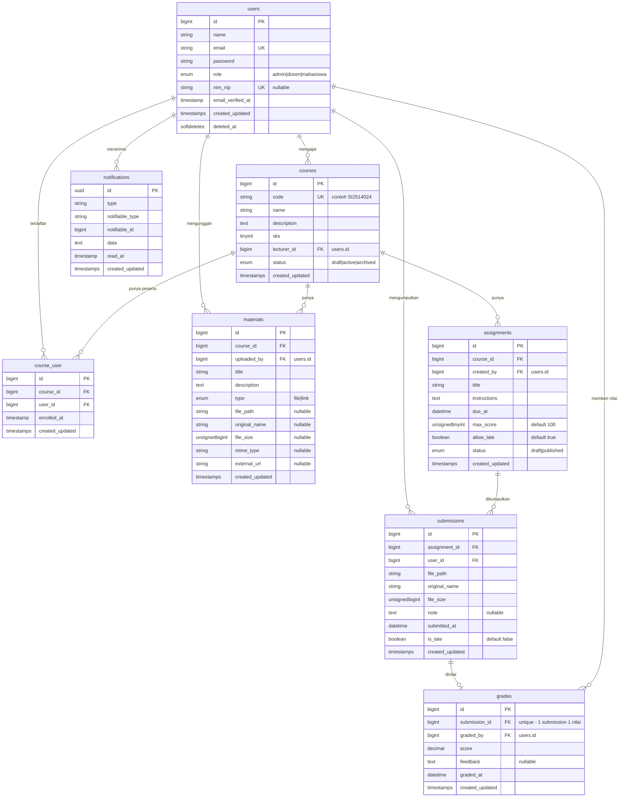

## 4. Skema Database (WAJIB)

### 4.1 Diagram Relasi



### 4.2 Constraint & Index Wajib

| Tabel | Ketentuan |
|-------|-----------|
| `users` | `email` unique; `nim_nip` unique nullable; index pada `role` |
| `courses` | `code` unique; FK `lecturer_id` → `users.id` `restrictOnDelete` |
| `course_user` | **unique composite** (`course_id`, `user_id`) — cegah enroll ganda |
| `materials` | FK `course_id` `cascadeOnDelete`; index `course_id` |
| `assignments` | FK `course_id` `cascadeOnDelete`; index (`course_id`, `due_at`) |
| `submissions` | **unique composite** (`assignment_id`, `user_id`) — 1 mahasiswa 1 submission aktif |
| `grades` | `submission_id` **unique** — relasi one-to-one |

Semua migrasi **wajib reversible** (`down()` benar-benar mengembalikan keadaan). Ini diuji.

### 4.3 Relasi Eloquent yang Diharapkan

Nama method relasi ikut ditetapkan, karena dipakai di modul, di soal interview, dan di skrip pengujian.

```
User      : taughtCourses()  hasMany(Course, 'lecturer_id')
            courses()        belongsToMany(Course)->withPivot('enrolled_at')->withTimestamps()
            submissions()    hasMany(Submission)
            gradesGiven()    hasMany(Grade, 'graded_by')

Course    : lecturer()       belongsTo(User, 'lecturer_id')
            students()       belongsToMany(User)->withPivot('enrolled_at')->withTimestamps()
            materials()      hasMany(Material)
            assignments()    hasMany(Assignment)

Assignment: course()         belongsTo(Course)
            submissions()    hasMany(Submission)
            grades()         hasManyThrough(Grade, Submission)

Submission: assignment()     belongsTo(Assignment)
            student()        belongsTo(User, 'user_id')
            grade()          hasOne(Grade)

Grade     : submission()     belongsTo(Submission)
            grader()         belongsTo(User, 'graded_by')
```

⚠️ Perhatikan `->withPivot('enrolled_at')`. Tanpa itu kolom `enrolled_at` yang diwajibkan pada tabel `course_user` tidak akan pernah terbaca maupun terisi lewat relasi — dan ini termasuk yang diperiksa saat penilaian Tugas 1.

### 4.4 Seeder Wajib

Agar penilaian konsisten, seeder harus menghasilkan **minimal**:
- 1 admin, 3 dosen, 30 mahasiswa
- 5 mata kuliah, tiap MK ≥ 15 mahasiswa terdaftar
- 3 tugas per MK, dengan campuran: sudah lewat deadline, aktif, dan draft
- ≥ 100 submission, ~60% di antaranya sudah dinilai

Data sebanyak ini **disengaja** — tanpa volume, N+1 query di minggu 11 tidak akan terasa.

Akun demo wajib (untuk penguji):
```
admin@kampuslms.test     / password
dosen@kampuslms.test     / password
mahasiswa@kampuslms.test / password
```

**Akun demo di server produksi.** Alamat surel di atas tetap dipakai supaya penguji dan CI tidak perlu menebak, tetapi **kata sandinya wajib diganti** saat deployment. Sediakan seeder terpisah untuk itu:

```bash
php artisan db:seed --class=DemoAccountSeeder --force
```

Kata sandi produksi ditulis di `docs/deployment.md` (yang boleh dibaca penguji), **bukan** di `README.md` yang terbuka untuk umum. Ini menyelesaikan pertentangan antara "akun demo harus dapat dipakai penguji" dan daftar periksa keamanan minggu 12.