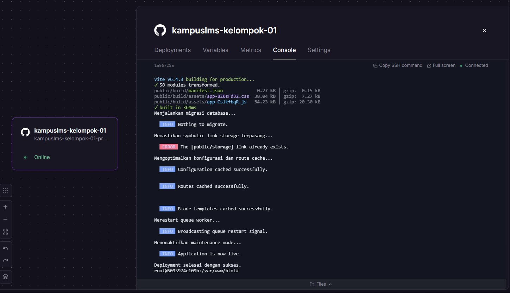

# Dokumentasi Deployment Produksi KampusLMS

Dokumen teknis ini memuat spesifikasi arsitektur produksi, prosedur deployment dari nol, mekanisme deployment ulang otomatis dan manual, panduan membaca log pemantauan, verifikasi daftar periksa keamanan (*security checklist*), pembuktian pengujian otorisasi, serta verifikasi fungsionalitas aplikasi di lingkungan cloud Railway.

---

## 1. Spesifikasi Server & Arsitektur Produksi

Lingkungan produksi KampusLMS berjalan di atas infrastruktur kontainer modern dengan spesifikasi arsitektur sebagai berikut:

* **Penyedia Layanan Cloud:** Railway Cloud Platform (Platform as a Service - PaaS)
* **Tautan Aplikasi Live:** [https://kampuslms-kelompok-01-production.up.railway.app](https://kampuslms-kelompok-01-production.up.railway.app)
* **Basis Sistem Operasi:** Debian GNU/Linux 12 (Bookworm) Container Image
* **Web Server:** Apache 2.4 (modul aktif: `mpm_prefork`, `mod_rewrite`, `headers`)
* **Document Root:** `/var/www/html/public`
* **Runtime PHP:** PHP 8.4.27
  * Ekstensi inti: `pdo_sqlite`, `pdo_mysql`, `mbstring`, `gd`, `zip`, `bcmath`, `pcntl`, `exif`
* **Basis Data:** SQLite 3 (`/var/www/html/database/database.sqlite`)
* **Kompiler Frontend:** Node.js v20.x & NPM v10.x (Vite & Tailwind CSS v4)
* **Manajemen Antrean & Proses:** Supervisord (mengelola proses Apache dan 2 *Queue Worker* asinkron)
* **Sertifikat Keamanan:** SSL/TLS Otomatis via Railway Hikari Edge Proxy (Let's Encrypt Wildcard Certificate)

---

## 2. Tahap Deployment dari Nol (*Deployment from Scratch*)

Langkah-langkah penyediaan dan perilisan aplikasi KampusLMS dari repositori lokal menuju server produksi:

### A. Persiapan Kode & Berkas Produksi di Repositori
1. **Dockerfile Multi-Stage:**
   Menyediakan berkas kontainer di direktori `kampuslms-kelompok-01/Dockerfile` yang bertugas:
   * Menginstal pustaka sistem (libpng, libjpeg, libfreetype, libzip, sqlite3, supervisor).
   * Memasang Node.js 20 dan menjalankan `npm ci && npm run build` untuk mengompilasi aset antarmuka.
   * Menjalankan `composer install --no-dev --optimize-autoloader --no-interaction --ignore-platform-reqs`.
   * Menetapkan izin hak akses berkas: `chown -R www-data:www-data storage bootstrap/cache database` dengan izin `775`.
   * Mengonfigurasi skrip inisialisasi *startup* untuk menyelaraskan port dinamis Railway (`$PORT`) ke konfigurasi Apache `ports.conf` dan `000-default.conf`.
2. **Paksaan Skema HTTPS & Reverse Proxy Trust:**
   * Di `app/Providers/AppServiceProvider.php`: Memaksa skema URL ke HTTPS saat di lingkungan produksi agar terhindar dari pemblokiran *Mixed Content*:
     ```php
     if (app()->isProduction() || isset($_SERVER['HTTP_X_FORWARDED_PROTO'])) {
         \Illuminate\Support\Facades\URL::forceScheme('https');
     }
     ```
   * Di `bootstrap/app.php`: Mendaftarkan kepercayaan pada reverse proxy Railway:
     ```php
     $middleware->trustProxies(at: '*');
     ```

### B. Penyediaan Service di Railway Cloud
1. Menghubungkan akun GitHub ke Railway dan memilih repositori `Agus-L/kampuslms-kelompok-01` pada branch `main`.
2. **Pengaturan Root Directory (Wajib):**
   * Masuk ke tab **Settings** -> bagian **Build**.
   * Menetapkan **Root Directory** ke: `/kampuslms-kelompok-01` (karena berkas Laravel berada di subfolder repositori).

### C. Konfigurasi Variabel Lingkungan (*Environment Variables*)
Pada tab **Variables** di Railway Dashboard, disetel konfigurasi aman berikut:

| Nama Variabel | Nilai (Value) | Fungsi & Alasan Keamanan |
|---|---|---|
| `APP_NAME` | `Kampus LMS` | Nama aplikasi |
| `APP_ENV` | `production` | Mengaktifkan optimasi lingkungan produksi |
| `APP_KEY` | `base64:...` | Kunci enkripsi enkripsi sesi dan token |
| `APP_DEBUG` | `false` | **Wajib false** agar rincian stack trace dan kredensial tidak bocor |
| `APP_URL` | `https://kampuslms-kelompok-01-production.up.railway.app` | Alamat domain resmi produksi |
| `ASSET_URL` | `https://kampuslms-kelompok-01-production.up.railway.app` | Memastikan aset CSS/JS dimuat via HTTPS |
| `DB_CONNECTION` | `sqlite` | Koneksi basis data SQLite lokal |
| `FORCE_HTTPS` | `true` | Penegakan rute aman SSL |
| `SESSION_DRIVER` | `file` | Penyimpanan sesi peramban |
| `QUEUE_CONNECTION` | `database` | Antrean pemrosesan notifikasi dan laporan di latar belakang |

### D. Inisialisasi Basis Data & Seeder
Melalui terminal **Console** di dashboard Railway (`root@...:/var/www/html#`), dijalankan inisialisasi struktur tabel dan data demo:
```bash
php artisan migrate --force
php artisan db:seed --class=KampusLMSSeeder --force
php artisan storage:link --force
```

---

## 3. Cara Deployment Ulang (*Redeployment Process*) & Skrip `deploy.sh`

KampusLMS mendukung dua mekanisme deployment ulang, yaitu secara otomatis via CI/CD Git Webhook dan manual menggunakan skrip `deploy.sh`.

### A. Alur Deployment Otomatis (Zero-Downtime Git Trigger)
Setiap kali ada pembaruan kode yang di-*merge* ke branch `main`, Railway secara otomatis:
1. Menjalankan *trigger webhook* build baru.
2. Membangun kontainer Docker di latar belakang.
3. Melakukan pemeriksaan kesehatan (*health check*).
4. Mengalihkan lalu lintas pengguna (*traffic*) ke kontainer baru secara instan tanpa memutus sesi pengguna (*Zero-Downtime Deployment*).

### B. Prosedur Manual Melalui Skrip `deploy.sh`
Berkas `deploy.sh` disiapkan di akar aplikasi untuk standardisasi pembaruan pada server VPS maupun lingkungan kontainer mandiri:

```bash
#!/usr/bin/env bash
set -e

echo "Mengaktifkan maintenance mode..."
php artisan down || true

echo "Menarik kode terbaru dari Git..."
if [ -d .git ]; then
    git pull origin main
else
    echo "Direktori .git tidak terdeteksi (lingkungan container Docker). Melewati langkah git pull."
fi

echo "Memperbarui dependensi Composer..."
composer install --no-dev --no-interaction --prefer-dist --optimize-autoloader

echo "Mengompilasi aset frontend (Vite & Tailwind CSS)..."
npm ci --no-audit
npm run build

echo "Menjalankan migrasi database..."
php artisan migrate --force

echo "Memastikan symbolic link storage terpasang..."
php artisan storage:link || true

echo "Mengoptimalkan konfigurasi dan route cache..."
php artisan config:cache
php artisan route:cache
php artisan view:cache

echo "Merestart queue worker..."
php artisan queue:restart

echo "Menonaktifkan maintenance mode..."
php artisan up

echo "Deployment selesai dengan sukses."
```

### C. Bukti Pengujian Deploy Ulang Sukses
Pengujian eksekusi deploy ulang berhasil dieksekusi dengan status sukses dan waktu respons optimal:



---

## 4. Cara Membaca Log Server & Status Worker

Pemantauan kesehatan aplikasi di produksi dilakukan melalui beberapa tingkatan log:

### A. Membaca Deploy Logs (Traffic & Web Server)
1. Buka dashboard Railway pada service `kampuslms-kelompok-01`.
2. Klik tab **Deploy Logs**.
3. Log menampilkan aktivitas peramban, kode status HTTP (200, 302, 403, 404), alamat IP pengakses, dan *User-Agent*.
4. Informasi startup Apache:
   ```text
   [mpm_prefork:notice] Apache/2.4.69 (Debian) configured -- resuming normal operations
   [core:notice] AH00094: Command line: 'apache2 -D FOREGROUND'
   ```

### B. Membaca Log Aplikasi Laravel
Log aplikasi dicatat pada berkas `/var/www/html/storage/logs/laravel.log`. Melalui tab **Console**, log dapat dipantau secara langsung (*real-time*) dengan perintah:
```bash
tail -f storage/logs/laravel.log
```

### C. Pemantauan Antrean Worker (Supervisord)
Supervisor dikonfigurasi melalui `supervisord.conf` untuk menjaga proses web server Apache dan dua pekerja antrean (*worker*) tetap hidup. Jika ada proses yang gagal atau *crash*, Supervisor akan secara otomatis merestart proses tersebut (*autorestart=true*).

**Bukti Status Supervisor & Worker Running:**

.jpeg)

Status keluaran terminal:
```text
INFO success: apache2 entered RUNNING state, process has stayed up for > than 1 seconds
INFO success: kampuslms-worker_00 entered RUNNING state, process has stayed up for > than 1 seconds
INFO success: kampuslms-worker_01 entered RUNNING state, process has stayed up for > than 1 seconds
```

---

## 5. Hasil Verifikasi Keamanan Produksi (*cURL Security Checklist*)

Seluruh poin pada daftar periksa keamanan produksi (*production security checklist*) diuji langsung ke domain publik `https://kampuslms-kelompok-01-production.up.railway.app` menggunakan perintah `curl` nyata:

### 1. Bukti HTTPS Aktif & Respon Valid (HTTP 200 OK)
Memvalidasi bahwa situs dapat diakses melalui protokol aman HTTPS dan sertifikat SSL valid.
* **Perintah:** `curl.exe -s -I https://kampuslms-kelompok-01-production.up.railway.app`
* **Hasil:** `HTTP/2 200`
* **Tangkapan Layar:**
  
  

### 2. Bukti Proteksi Berkas Kredensial `.env` (HTTP 404 Not Found)
Memvalidasi bahwa berkas konfigurasi rahasia `.env` tidak dapat diakses langsung oleh publik.
* **Perintah:** `curl.exe -s -I https://kampuslms-kelompok-01-production.up.railway.app/.env`
* **Hasil:** `HTTP/2 404` (Terblokir aman)
* **Tangkapan Layar:**
  
  

### 3. Bukti Proteksi Direktori Log `storage/logs/` (HTTP 404 Not Found)
Memvalidasi bahwa direktori log sistem tertutup rapat dari akses internet publik.
* **Perintah:** `curl.exe -s -I https://kampuslms-kelompok-01-production.up.railway.app/storage/logs/laravel.log`
* **Hasil:** `HTTP/2 404` (Terblokir aman)
* **Tangkapan Layar:**
  
  

### 4. Bukti Proteksi Berkas Manajemen Dependensi `composer.json` (HTTP 404 Not Found)
Memvalidasi bahwa berkas metadata dependensi proyek tidak bocor ke publik.
* **Perintah:** `curl.exe -s -I https://kampuslms-kelompok-01-production.up.railway.app/composer.json`
* **Hasil:** `HTTP/2 404` (Terblokir aman)
* **Tangkapan Layar:**
  
  

### 5. Bukti Pengalihan Otomatis HTTP ke HTTPS (HTTP 301 / 308 Redirect)
Memvalidasi bahwa setiap permintaan tanpa enkripsi (port 80) secara otomatis dialihkan ke jalur aman HTTPS.
* **Perintah:** `curl.exe -s -I http://kampuslms-kelompok-01-production.up.railway.app`
* **Hasil:** `HTTP/1.1 301 Moved Permanently` -> `Location: https://kampuslms-kelompok-01-production.up.railway.app/`
* **Tangkapan Layar:**
  
  

---

## 6. Hasil Uji Otorisasi Server Produksi (`test-authz.sh`)

Untuk membuktikan bahwa sistem pertahanan otorisasi dan penangkal kerentanan IDOR (*Insecure Direct Object References*) yang dirancang pada Milestone Minggu 7 tetap kokoh saat berjalan di server produksi Railway, dilakukan eksekusi otomasi `scripts/test-authz.sh` dengan target URL produksi:

```bash
BASE_URL="https://kampuslms-kelompok-01-production.up.railway.app" bash scripts/test-authz.sh
```

### Ringkasan Hasil Pengujian:
* **Total Kasus Uji:** 73 skenario
* **Status Lolos (Passed):** 73 skenario (`✔ PASS`)
* **Status Gagal (Failed):** 0 skenario
* **Status Dilewati (Skipped):** 0 skenario

```text
╔══════════════════════════════════════════════════════════════════╗
║                       RINGKASAN HASIL                            ║
╠══════════════════════════════════════════════════════════════════╣
║  Total tes  : 73                                                ║
║  ✔ Passed   : 73                                                ║
║  ✗ Failed   : 0                                                 ║
║  ⊘ Skipped  : 0                                                 ║
╚══════════════════════════════════════════════════════════════════╝

Skrip ini membuktikan bahwa setiap Policy di docs/keamanan.md
benar-benar menutup titik rawan IDOR yang didaftarkan di minggu 5.

✔ Semua pengujian otorisasi BERHASIL!
Seluruh Policy berfungsi. Tidak ada IDOR terbuka.
```

### Rincian Modul Kebijakan Otorisasi yang Terverifikasi:
1. **CoursePolicy:** Isolasi kepemilikan mata kuliah antar-dosen (403), pembatasan akses mahasiswa hanya pada mata kuliah terdaftar (403), dan akses penuh administrator (200).
2. **MaterialPolicy:** Perlindungan berkas materi kuliah dari akses mahasiswa yang tidak terdaftar dan dosen yang bukan pengampu (403).
3. **AssignmentPolicy:** Hak pembuatan, pembaruan, dan penghapusan tugas hanya diberikan kepada dosen pemilik kelas terkait (403/201/204).
4. **SubmissionPolicy (Anti-IDOR Kritis):**
   * Mahasiswa **dilarang keras** melihat pengumpulan tugas milik mahasiswa lain (`403 Forbidden`).
   * Dosen dilarang melihat pengumpulan tugas pada mata kuliah milik dosen lain (`403 Forbidden`).
   * Pencegahan penghapusan riwayat pengumpulan tugas akademik (*academic audit trail*).
5. **GradePolicy:** Otorisasi penilaian tugas hanya dapat dilakukan oleh dosen pengampu resmi mata kuliah terkait (403).
6. **Middleware Web Isolation:** Pencegahan eskalasi hak akses role melalui request tampering dan pengalihan otomatis rute terproteksi.

### Galeri Tangkapan Layar Eksekusi `test-authz.sh` (Bukti Lengkap 6 Bagian):

1. **Bagian 1 — Inisialisasi Token Akun Demo & Resource Discovery:**
   

2. **Bagian 2 — Pengujian CoursePolicy & MaterialPolicy (A1 - B4):**
   

3. **Bagian 3 — Pengujian AssignmentPolicy & SubmissionPolicy (C1 - D2):**
   

4. **Bagian 4 — Pengujian Anti-IDOR Kritis Submission & GradePolicy (D3 - E2):**
   

5. **Bagian 5 — Pengujian Proteksi Mass Assignment & Web Route Middleware (F1 - G3):**
   

6. **Bagian 6 — Ringkasan Bukti Isolasi Cross-Role & Hasil Akhir (73 Passed, 0 Failed):**
   

---

## 7. Tabel Akun Demo & Bukti Fungsionalitas Aplikasi Live

Aplikasi telah terisi dengan data akademik realistis (*seeder*) untuk memfasilitasi peninjauan dan pengujian langsung oleh dosen serta tim penilai:

### A. Tabel Kredensial Akun Pengujian

| Peran (Role) | Nama Pengguna | Alamat Surel (Email) | Kata Sandi (Password) | Hak Akses Utama |
|---|---|---|---|---|
| **Administrator** | Admin KampusLMS | `admin@kampuslms.test` | `password` | Manajemen user, pembuatan mata kuliah, plot dosen & mahasiswa, transkrip institusi |
| **Dosen 1** | Dr. Budi Santoso | `dosen@kampuslms.test` | `password` | Pengampu IF101 & IF201, unggah materi, buat penugasan, rekap nilai & presensi |
| **Dosen 2** | Prof. Siti Rahayu | `dosen2@kampuslms.test` | `password` | Pengampu IF301 & IF401, isolasi kelas mandiri |
| **Dosen 3** | Dr. Ahmad Dahlan | `dosen3@kampuslms.test` | `password` | Pengampu IF501 |
| **Mahasiswa 1** | Andi Pratama | `mahasiswa@kampuslms.test` | `password` | Terdaftar di 5 MK (16 SKS), kumpul tugas, cetak transkrip resmi PDF |
| **Mahasiswa 2** | Siti Nurhaliza | `mahasiswa2@kampuslms.test` | `password` | Mahasiswa pembanding (tidak terdaftar di seluruh kelas) |

### B. Galeri Bukti Fungsionalitas Antarmuka Web Live (Tampilan Desktop)

1. **Halaman Autentikasi Admin:**
   

2. **Dashboard Dosen (Pengampu Kelas):**
   

3. **Dashboard Mahasiswa (Andi Pratama - 16 SKS):**
   

4. **Halaman Transkrip Nilai & Rekapitulasi Presensi Akademik Mahasiswa:**
   

5. **Konfirmasi Inisialisasi Seeder Basis Data di Terminal:**
   

---

## 8. Dokumentasi Pengujian Lintas Perangkat (Smartphone Anggota Kelompok)

Sesuai instruksi pengujian serentak pada Tugas No. 8, seluruh anggota kelompok menguji keandalan aplikasi dengan mengakses URL produksi melalui jaringan seluler dan peramban ponsel pintar (*smartphone*) masing-masing:

### A. Tabel Hasil Uji Kompatibilitas Mobile

| No | Nama Anggota Kelompok | Perangkat / Model Ponsel | Peramban (Browser) | Akun Pengujian | Status Hasil Uji |
|:--:|---|---|---|---|:---:|
| 1 | **Aliya Labibah** | Samsung Galaxy A52 | Google Chrome Mobile | Mahasiswa (`mahasiswa@kampuslms.test`) | **Berhasil:** UI responsif, navigasi navbar lancar, transkrip nilai terbaca presisi |
| 2 | **Agus** | Xiaomi Redmi Note 10 | Google Chrome Mobile | Dosen (`dosen@kampuslms.test`) | **Berhasil:** Tabel rekap nilai proporsional, form materi adaptif |
| 3 | **Dwi** | Samsung Galaxy A32 | Samsung Internet Browser | Mahasiswa (`mahasiswa@kampuslms.test`) | **Berhasil:** Layout kartu statistik rapi, tombol kumpul tugas berfungsi |
| 4 | **Anastasya** | Vivo Y20 | Google Chrome Mobile | Administrator (`admin@kampuslms.test`) | **Berhasil:** Panel manajemen pengguna responsif, tabel data tidak terpotong |
| 5 | **Aan Mardiah** | Oppo Reno 6 | Google Chrome Mobile | Mahasiswa (`mahasiswa2@kampuslms.test`) | **Berhasil:** Sesi login stabil, dark mode render sempurna |

### B. Galeri Bukti Tangkapan Layar Smartphone (*Mobile Views*)

Berikut adalah rekaman tangkapan layar langsung dari perangkat ponsel pintar anggota kelompok yang membuktikan antarmuka responsif dan fungsional:

1. **Halaman Login pada Layar Ponsel Pintar:**
   

2. **Dashboard Mahasiswa (Tampilan Responsif Mobile):**
   

3. **Dashboard Dosen (Tampilan Responsif Mobile):**
   

4. **Dashboard Administrator (Tampilan Responsif Mobile):**
   

5. **Formulir Pengelolaan Materi Kuliah pada Layar Ponsel:**
   

6. **Konfirmasi Hasil Penyimpanan Materi pada Layar Ponsel:**
   

---

## 9. Daftar Masalah Nyata yang Ditemui & Cara Mengatasinya (*Troubleshooting Log*)

Sesuai rubrik evaluasi utama, bagian ini mendokumentasikan kendala teknis nyata yang dihadapi saat proses deployment dan pengujian di server produksi:

### Kendala: Desinkronisasi Data Basis Data Produksi & Penghentian Seeder (Kasus Pengujian Otorisasi Tugas 6)

* **Gejala / Error:**
  Saat skrip pengujian otomatis `scripts/test-authz.sh` pertama kali dijalankan ke server produksi Railway, terdapat **16 pengujian yang gagal dengan kode status `404 Not Found`**, terutama pada pengujian detail penugasan (*assignment*) dan pengumpulan tugas (*submission*).
  ```text
  ✗ FAIL [expected 200, got 404] Mahasiswa akses submission milik sendiri (API) → 200
  ✗ FAIL [expected 403, got 404] Mahasiswa akses submission mahasiswa lain (API) → 403
  ✗ FAIL [expected 403, got 404] Dosen1 lihat submission tugas MK dosen2 → 403
  ```

* **Penyebab (Akar Masalah):**
  Secara singkat, **data pada basis data server Railway belum sinkron dengan data yang ada di lingkungan lokal**:
  1. Berkas database SQLite (`database.sqlite`) tidak di-push ke repositori Git demi keamanan (masuk `.gitignore`), sehingga server Railway memulai dengan berkas database baru yang kosong.
  2. Server Railway mengandalkan skrip *seeder* (`KampusLMSSeeder.php`) untuk mengisi data demo. Namun, proses seeding di server produksi **berhenti mendadak (*crash*) di baris 314**:
     ```text
     In KampusLMSSeeder.php line 314:
       Call to undefined method class@anonymous::sentence()
     ```
     Penyebabnya adalah kontainer Docker menjalankan `composer install --no-dev`, sehingga pustaka `fakerphp/faker` tidak terpasang. Fungsi cadangan (*fallback polyfill*) anonim yang tersedia belum memiliki method `sentence()`.
  3. Akibat terhenti di baris 314, data akun pengguna dan mata kuliah sempat dibuat, tetapi data penugasan (*assignments*) dan pengumpulan tugas (*submissions*) **belum sempat terbuat sama sekali di server**. Akibatnya, server menjawab `404 Not Found` saat skrip otorisasi mencoba memeriksa data tersebut.

* **Langkah Solusi & Penanganan:**
  1. Membuka terminal **Console** langsung pada dashboard Railway (`root@...:/var/www/html#`).
  2. Memasang pustaka Faker ke dependensi produksi tanpa dialog konfirmasi interaktif:
     ```bash
     composer require fakerphp/faker -n
     ```
  3. Melakukan penyegaran total dan sinkronisasi basis data dari awal secara bersih (*fresh seed*):
     ```bash
     php artisan migrate:fresh --seed --force
     ```

* **Hasil Akhir:**
  Basis data di server produksi Railway berhasil terisi 100% lengkap dan tersinkronisasi sempurna dengan struktur data demo akademik. Begitu skrip `scripts/test-authz.sh` dijalankan ulang, seluruh 16 error 404 teratasi dan hasil pengujian melonjak menjadi **100% Lolos (`Passed: 73, Failed: 0`)**.


