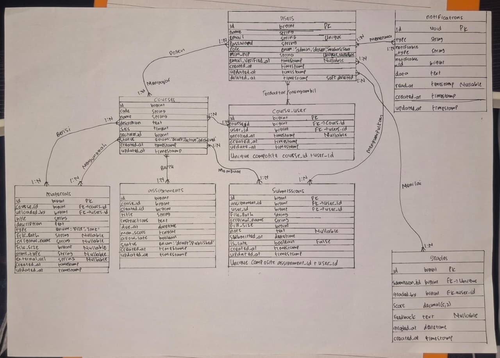

# Catatan Minggu 3
## Identitas anggota kelompok 1
| Nama | NIM |
| :--- | :--- |
| Aan Mardiah | 10241001 |
| Agus Liberty Purba | 10241005 |
| Aliya Labibah | 10241007 |
| Anastasya Salsabila Khoirunnisa  | 10241009 |
| Annisa Dwi Lestari Sonny | 10241011 |

## **Read**
### **1. Gambar ulang ERD dari spesifikasi di papan/kertas, tanpa melihat dokumen.** 

### **2. Untuk setiap foreign key, tentukan perilaku `onDelete`-nya dan tuliskan alasannya**

#### 1. Tabel `courses`

| Kolom FK | Merujuk ke | Perilaku onDelete |
|----------|------------|-------------------|
| `lecturer_id` | `users.id` | `restrictOnDelete` |

**Alasan:** Dosen yang masih mengampu mata kuliah tidak boleh dihapus. Kalau dosen dihapus, mata kuliahnya jadi "yatim" — tidak punya pengampu. Dengan `restrict`, database menolak penghapusan dosen selama masih ada mata kuliah yang terhubung dengannya. Admin harus pindahkan atau hapus mata kuliahnya dulu, baru dosennya bisa dihapus.

---

#### 2. Tabel `course_user` (pivot enrollment)

| Kolom FK | Merujuk ke | Perilaku onDelete |
|----------|------------|-------------------|
| `course_id` | `courses.id` | `cascadeOnDelete` |
| `user_id` | `users.id` | `cascadeOnDelete` |

**Alasan `course_id` → cascade:** Kalau mata kuliah dihapus, data enrollment mahasiswa di mata kuliah itu tidak bermakna lagi. Masuk akal kalau ikut terhapus otomatis.

**Alasan `user_id` → cascade:** Kalau mahasiswa dihapus dari sistem, catatan enrollment-nya juga tidak berguna lagi. Ikut terhapus otomatis.

---

#### 3. Tabel `materials`

| Kolom FK | Merujuk ke | Perilaku onDelete |
|----------|------------|-------------------|
| `course_id` | `courses.id` | `cascadeOnDelete` |
| `uploaded_by` | `users.id` | `nullOnDelete` |

**Alasan `course_id` → cascade:** Materi adalah bagian dari mata kuliah. Kalau mata kuliahnya dihapus, materinya memang sudah tidak relevan lagi — ikut terhapus.

**Alasan `uploaded_by` → null:** Materi tetap berguna buat mahasiswa walaupun dosen pengunggahnya sudah dihapus dari sistem. Jadi materinya dipertahankan, tapi kolom `uploaded_by` diset jadi NULL (pengunggahnya tidak diketahui lagi).

---

#### 4. Tabel `assignments`

| Kolom FK | Merujuk ke | Perilaku onDelete |
|----------|------------|-------------------|
| `course_id` | `courses.id` | `cascadeOnDelete` |
| `created_by` | `users.id` | `nullOnDelete` |

**Alasan `course_id` → cascade:** Sama seperti materi — tugas adalah bagian dari mata kuliah. Kalau mata kuliahnya dihapus, tugas-tugasnya juga sudah tidak ada konteksnya. Ikut terhapus.

**Alasan `created_by` → null:** Tugas tetap perlu ada walaupun dosen pembuatnya dihapus, karena mahasiswa mungkin masih perlu mengumpulkan atau melihat tugasnya. Kolom `created_by` diset NULL saja.

---

#### 5. Tabel `submissions`

| Kolom FK | Merujuk ke | Perilaku onDelete |
|----------|------------|-------------------|
| `assignment_id` | `assignments.id` | `cascadeOnDelete` |
| `user_id` | `users.id` | `cascadeOnDelete` |

**Alasan `assignment_id` → cascade:** Submission adalah jawaban dari sebuah tugas. Kalau tugasnya dihapus, submission-nya juga tidak bermakna lagi — ikut terhapus.

**Alasan `user_id` → cascade:** Kalau mahasiswa dihapus dari sistem, submission miliknya juga tidak perlu disimpan lagi — ikut terhapus.

---

#### 6. Tabel `grades`

| Kolom FK | Merujuk ke | Perilaku onDelete |
|----------|------------|-------------------|
| `submission_id` | `submissions.id` | `cascadeOnDelete` |
| `graded_by` | `users.id` | `nullOnDelete` |

**Alasan `submission_id` → cascade:** Nilai adalah penilaian atas sebuah submission. Kalau submission-nya dihapus, nilainya juga tidak ada artinya — ikut terhapus.

**Alasan `graded_by` → null:** Nilai tetap penting buat mahasiswa walaupun dosen penilainya sudah dihapus dari sistem. Nilainya dipertahankan, tapi kolom `graded_by` diset NULL.

---

#### 7. Tabel `notifications`

| Kolom FK | Merujuk ke | Perilaku onDelete |
|----------|------------|-------------------|
| `notifiable_id` + `notifiable_type` | Polimorfik (biasanya `users`) | Tidak ada FK constraint di database |

**Alasan:** Tabel `notifications` menggunakan relasi polimorfik bawaan Laravel. Relasi ini tidak pakai foreign key constraint di level database — Laravel yang mengelolanya di level aplikasi. Jadi tidak ada perilaku onDelete yang perlu ditentukan di migration. 

### 3. **Apa yang terjadi pada mata kuliah jika seorang dosen dihapus?**

   Sistem akan menolak penghapusan akun dosen jika ia masih terdaftar mengajar suatu mata kuliah. Hal ini dirancang untuk menjaga integritas data agar mata kuliah tidak kehilangan informasi pengajar, sekaligus mencegah error sistem yang dapat mengakibatkan rusak atau hilangnya riwayat penting seperti nilai, tugas, dan materi kuliah.

### 4. **kenapa `grades.submission_id` bersifat `unique`, bukan sekadar index biasa?**

   Karena satu submission hanya boleh dinilai satu kali. Kalau hanya pakai index biasa, database tidak akan mencegah dosen menginput dua nilai untuk submission yang sama — dan itu tidak masuk akal secara logika. Dengan `unique`, database langsung menolak jika ada upaya duplikasi nilai untuk submission yang sudah ada nilainya. Ini juga yang mewujudkan relasi **one-to-one** antara tabel `submissions` dan `grades` — satu submission, satu nilai, tidak lebih.
